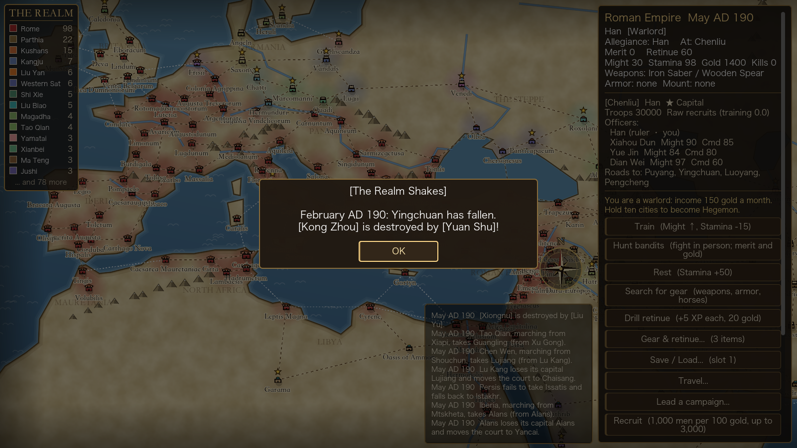
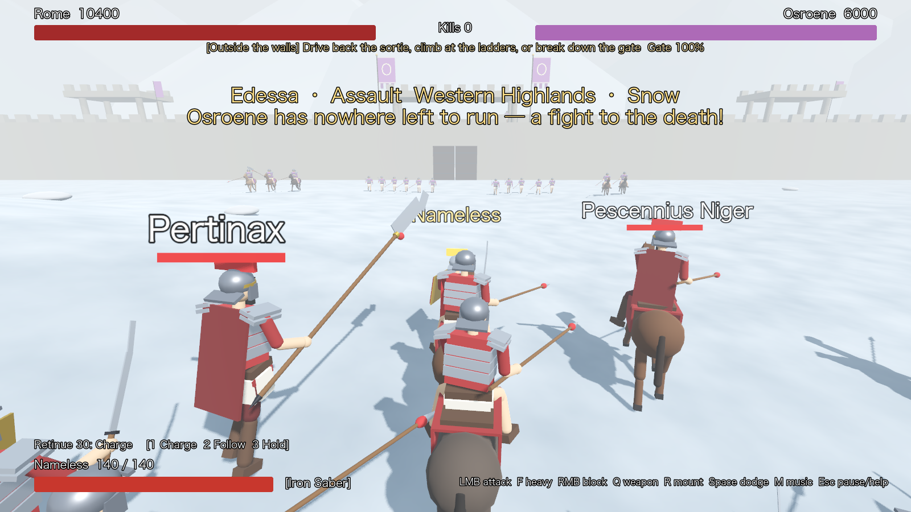

# Warlord Rising · 乱世从戎

A historical strategy game built in Godot 4: start as a common soldier, fight
your way up in real-time 3D battles, and end as a warlord ruling an empire.
The map runs from Britain and North Africa to Korea and Japan, across four eras.

从一名小卒做起，在 3D 战场上亲手拼杀，一路做到割据一方的霸主。地图西起不列颠与北非，
东到朝鲜与日本，共四个时代。




## Features · 特色

- **Four eras · 四个时代** — Warring States (战国), the fall of Han (汉末),
  Sui–Tang transition (隋末唐初), Five Dynasties (五代十国); each with the
  contemporary powers of Eurasia, from Rome and Parthia to the Caliphate.
- **Career · 从戎之路** — soldier → officer → governor → warlord → hegemon.
  Recruit officers, send them on campaigns, appoint governors, move your capital.
- **3D battles · 3D 战斗** — field battles, sieges with ladders and gates, and a
  final palace fight when a capital falls. Fight in person, on foot or mounted,
  and command your retinue.
- **Diplomacy · 外交** — gifts, alliances, allied reinforcements, betrayal.
- **Period dress and architecture · 因时因地** — armour, shields, city walls and
  halls change with culture and era; famous powers fly their standards.
- **Chinese and English · 中英双语** — switch on the title screen.
- **Gamepad support · 手柄** — playable with a controller (tested with Joy-Con).

## Run · 运行

Requires [Godot 4.7](https://godotengine.org/) or newer. No other dependencies;
every scene, model and sound is generated in code.

```sh
git clone https://github.com/HirahTang/warlord-rising.git
cd warlord-rising
godot --path .
```

On macOS you can also double-click `乱世从戎.command`.

## Controls · 操作

| | Keyboard / mouse |
|---|---|
| Move · 移动 | WASD |
| Attack / heavy · 攻击 / 重击 | LMB / F |
| Block · 格挡 | RMB |
| Dodge · 闪避 | Space |
| Switch weapon · 换武器 | Q |
| Mount / dismount · 上下马 | R |
| Retinue orders · 亲兵号令 | 1 charge · 2 follow · 3 hold |
| Music · 音乐 | M |
| Pause / help · 暂停 | Esc |

## Development · 开发

Everything is GDScript under `scripts/`; scenes are built in code.

```sh
godot --headless --path . -s tools/smoke_test.gd   # regression test, ~5 min, expects "失败项：0"
python3 tools/gen_scenarios.py                     # regenerate scripts/Scenarios.gd
python3 tools/gen_lang.py                          # regenerate scripts/LangData.gd (English text)
python3 tools/gen_audio.py                         # regenerate audio/*.wav
```

`scripts/Scenarios.gd` and `scripts/LangData.gd` are generated — edit the
generators in `tools/`, not the output.

## License

[MIT](LICENSE)
